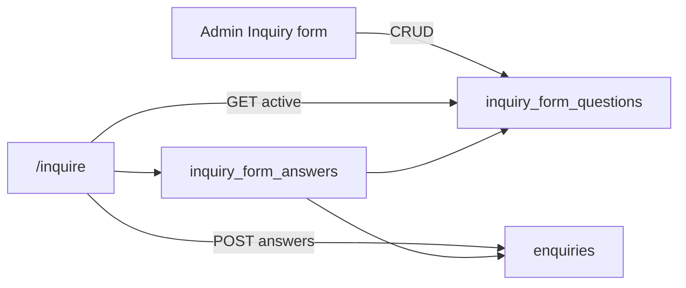

# Inquiry form builder

Owner: Charity | Branch: main | Status: verified

## Part A: Spec (contract for teammates)

### User stories

| ID | Role | Story | Acceptance |
| :--- | :--- | :--- | :--- |
| US-1 | admin | Manage survey questions (add, edit, reorder, activate/deactivate, delete) | Given admin is signed in, when they open Inquiry form and save a question, then it appears in the admin list and persists after refresh. |
| US-2 | visitor (public) | Complete a dynamic survey then fixed contact step | Given active questions exist, when the visitor answers each step and submits name/phone/address/city, then an enquiry is created with answers stored and known fields mapped. |
| US-3 | sales / other staff | Cannot edit the form definition | Given a non-admin staff user, when they call admin question APIs or open the nav item, then they get 403 / no nav entry. |
| US-4 | admin | Seeded form matches the previous static survey | Given a fresh seed, when a visitor opens `/inquire`, then the active steps include ownership, roof type, terrace, power cuts, bill, and system-size fields with the same labels/options as before. |

### Roles and permissions

| Action | admin | sales | warehouse | technician | support | public |
| :--- | :---: | :---: | :---: | :---: | :---: | :---: |
| `GET /api/public/inquiry-form` | yes | yes | yes | yes | yes | yes |
| `GET /api/admin/inquiry-questions` | yes | no | no | no | no | no |
| `POST /api/admin/inquiry-questions` | yes | no | no | no | no | no |
| `PATCH /api/admin/inquiry-questions/:id` | yes | no | no | no | no | no |
| `DELETE /api/admin/inquiry-questions/:id` | yes | no | no | no | no | no |
| `POST /api/public/enquiries` (with answers) | — | — | — | — | — | yes |

### API contract

#### `GET /api/public/inquiry-form`

- Roles: public
- Response `data`: `{ questions: InquiryQuestionPublic[] }`
- Each public question: `{ id, key, label, helpText, fieldType, options, mapsTo, sortOrder, isRequired }`
- Only `isActive: true`, ordered by `sortOrder` ascending.
- `options` is `null` or `{ value: string, label: string, mapValue?: number \| boolean \| string }[]`.

#### `GET /api/admin/inquiry-questions`

- Roles: admin
- Response `data`: `InquiryQuestion[]` (includes inactive, `createdAt`, `updatedAt`, `isActive`).

#### `POST /api/admin/inquiry-questions`

- Roles: admin
- Body:
  - `key` string trim min 1, unique, snake/kebab-safe (`^[a-z][a-z0-9_]*$`)
  - `label` string trim min 1
  - `helpText` string trim optional / nullable
  - `fieldType` enum: `single_choice` \| `select` \| `text` \| `number` \| `boolean`
  - `options` array required when `single_choice` or `select` (min 1); otherwise null/omitted
  - `mapsTo` optional enum: `requestedKw` \| `systemKind` \| `wantsSubsidy` \| `monthlyBillInr` \| `roofAreaSqft` \| `gridSuitable` \| null
  - `sortOrder` int >= 0
  - `isRequired` boolean default true
  - `isActive` boolean default true
- Response 201 `data`: full question
- Errors: 400 validation, 409 duplicate key

#### `PATCH /api/admin/inquiry-questions/:id`

- Roles: admin
- Body: partial of create (at least one field). Same option rules when `fieldType` is choice/select.
- Response `data`: full question
- Errors: 400, 404, 409

#### `DELETE /api/admin/inquiry-questions/:id`

- Roles: admin
- Soft-delete preferred: set `isActive: false` when answers exist; hard-delete when no answers.
- Response `data`: `{ id, deleted: "hard" \| "soft" }`
- Errors: 404

#### `POST /api/public/enquiries` (extended)

- Existing contact + enquiry fields remain required for customer upsert.
- New optional body field: `answers: { questionId: string, value: string \| number \| boolean }[]`
- Server validates each active required question has an answer when `answers` is sent (or when any active questions exist — always validate against active set).
- Maps `mapsTo` + option `mapValue` into enquiry columns; appends human-readable lines to `notes`; inserts `inquiry_form_answers` rows.
- If no answer maps to `requestedKw`, keep body `requestedKw` (still required on the public body for backward compatibility). Prefer mapped answer when present.
- Response unchanged: `{ customer, enquiry }`.

### Screens

#### S1 — Admin Inquiry form (`/app/inquiry-form`)

- Purpose: CRUD for survey questions.
- Fields: key, label, help text, type, options editor (value/label/mapValue), maps-to, sort order, required, active.
- Actions: Add question, Edit, Deactivate/Delete, Refresh.
- States: loading skeleton `data-testid="inquiry-form-skeleton"`; empty `data-testid="inquiry-form-empty"`; error Alert + Retry; forbidden via role (nav hidden + API 403).
- Data: admin list endpoint.

#### S2 — Public `/inquire` (updated)

- Purpose: wizard driven by `GET /api/public/inquiry-form`, then fixed contact step (name, phone, email, address, city, PIN).
- Progress: step N of (questions.length + 1).
- States: loading skeleton while form loads; empty if zero active questions (still allow contact-only submit with required `requestedKw` default 3); error Alert + Retry on form load or submit failure.
- Data: public form + `POST /api/public/enquiries`.

### Depends on

- Customers + enquiries tables (real).
- Catalog `createPublicEnquiry` (real) — extended in place.
- Auth admin role (real).

### Assumptions (reviewed with the developer)

| # | Assumption | Decision |
| :--- | :--- | :--- |
| 1 | Schema | A — `inquiry_form_questions` + `inquiry_form_answers` + migration |
| 2 | Contact fields | A — always fixed on `/inquire`; only survey steps are dynamic |
| 3 | Existing steps | A — seed current survey questions into DB |
| 4 | Answers storage | A — answer rows + map known keys into enquiry columns / notes |
| 5 | Branch | Work on `main` (developer choice; skill default was `feat/…`) |

## Part B: Walkthrough

### 1. Try it live

1. Ensure Postgres is up, then `pnpm db:migrate` and `pnpm --filter backend db:seed` (seeds 8 survey questions).
2. `pnpm dev:real`. Open `/inquire`. You should see **Step 1 of 9** and **Do you own the roof?**
3. Answer Yes → Next through roof type, terrace, power cuts, bill, kW (e.g. `3`), system On-grid, leave subsidy checked or not.
4. Contact: name `Harpreet Kaur`, phone a unique 10-digit number, address `22 Civil Lines`, city `Jalandhar`. Submit. Note the `enq-…` reference. Refresh `/inquire` — wizard resets; enquiry stays in DB.
5. Sign in as `admin@sunpower.in` / `hackathon`. Open **Inquiry form**. Edit a label (e.g. change terrace wording), Save, Refresh — change remains. Open `/inquire` again and confirm the new label.
6. Sign out, sign in as `sales@sunpower.in`. **Inquiry form** is not in the nav; `/app/inquiry-form` does not load the admin table for that role.

### 2. How it works

`InquiryPage` → `usePublicInquiryForm` → `GET /api/public/inquiry-form` → `listPublicInquiryForm` reads `inquiry_form_questions`. Submit sends `answers[]` on `POST /api/public/enquiries`; `createPublicEnquiry` calls `resolveInquiryAnswers`, maps columns, writes `notes`, inserts `inquiry_form_answers`, upserts the customer. Admin UI at `/app/inquiry-form` uses `requireRole("admin")` CRUD on `/api/admin/inquiry-questions`.

### 3. What you can add next

- Preview pane on the admin page (small).
- Drag-and-drop reorder instead of numeric sort order (medium).
- Show stored answers on enquiry detail (medium).
- Conditional questions / branching (large).
- Multi-language labels (large).

### 4. Test coverage

| Story | Proof |
| :--- | :--- |
| US-1 | `tests/inquiry-form.e2e.mjs` create/patch/delete |
| US-2 | `tests/inquiry-form.e2e.mjs` + `tests/landing-ui.e2e.mjs` submit with answers |
| US-3 | e2e auth matrix 401/403 for sales/anon |
| US-4 | e2e asserts seeded ownership question label |

Cursor browser: public wizard loaded seeded Q1; admin list showed 8 active rows; sales had no nav entry.
