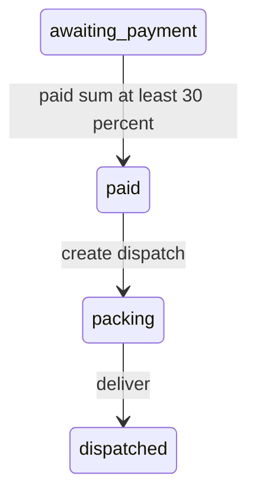

# Orders, payments, and dispatch

Owner: orders-dispatch | Branch: feat/orders-dispatch | Status: verified

## Part A: Spec (contract for teammates)

### User stories

| ID | Role | Story | Acceptance |
| :--- | :--- | :--- | :--- |
| US-1 | sales | See confirmed orders after a quote is accepted | Given a staff token, When GET /api/orders, Then each row includes customer name, total, and status |
| US-2 | sales | Record a customer payment (UPI or other method) | Given an awaiting-payment order, When POST a payment with amount, kind, method, and reference, Then the payment is stored and Paid / Balance update |
| US-3 | sales | Unlock packing once 30% is collected | Given total T, When recorded payments sum to at least 0.3 × T (a 50% advance also qualifies), Then status becomes paid |
| US-4 | sales | Hold packing until the advance gate | Given paid sum below 30%, When warehouse creates a dispatch, Then the API returns 422 |
| US-5 | sales | Set install date and lead technician after the gate | Given a paid (or later, not cancelled) order, When POST /schedule with datetime and technician id, Then the order date is saved and an installation row is scheduled |
| US-6 | warehouse | Pack a paid order | Given status paid, When POST /api/dispatches, Then a packing dispatch exists and the order becomes packing |
| US-7 | warehouse | Scan serials onto the dispatch | Given an in-stock serial, When scan-out with that dispatch, Then the serial is dispatched and linked. A serial already on another order returns 409. An unknown serial returns 404 |
| US-8 | warehouse | Deliver and start the warranty clock | Given a packing or in-transit dispatch, When deliver, Then dispatch and linked serials get deliveredAt and the order becomes dispatched |

### Roles and permissions

| Action | admin | sales | warehouse | technician | support |
| :--- | :--- | :--- | :--- | :--- | :--- |
| Read orders, payments, stock, serials, dispatches | yes | yes | yes | yes | yes |
| Create order from accepted quote, record payment, patch order, schedule | yes | yes | no | no | no |
| Adjust stock, add serial, scan-out, create/move/deliver dispatch | yes | no | yes | no | no |
| List technicians via existing `GET /api/staff?role=technician` | yes | yes | yes | yes | yes |

Customer portal records UPI payments on own orders (`POST /api/customer/orders/:id/payments`). Staff still use `/api/orders/:id/payments`.

### API contract

Advance gate: `round(paidInr × 100) × 10 >= round(totalInr × 100) × 3`. Only `awaiting_payment` flips to `paid`. Later statuses are not moved backward. A cancelled order rejects new payments.

List and detail orders add `customerName`, `paidInr`, `balanceInr`. Detail also adds `payments`, `dispatchIds`, `installationId`, `leadTechnicianId`.

Stock rows add `productSku`, `productName`. Serial rows add `productName`, `productSku`. Dispatch rows add `customerName`. Dispatch detail includes `serialUnitIds`.

| Method | Path | Roles | Body / rules |
| :--- | :--- | :--- | :--- |
| GET | `/api/orders?status=` | any staff | Optional status enum |
| POST | `/api/orders` | sales, admin | `{ quoteId }` only if quote is accepted and has no order. 409 if an order exists |
| GET | `/api/orders/:id` | any staff | Detail shape above. 404 if missing |
| PATCH | `/api/orders/:id` | sales, admin | `{ scheduledInstallAt?, siteAddress?, status? }`. `status` may only be `cancelled`, and not once packing, dispatched, installing, or completed. Setting `scheduledInstallAt` requires the 30% gate (same as schedule) |
| POST | `/api/orders/:id/schedule` | sales, admin | `{ scheduledInstallAt, leadTechnicianId }`. Order must be paid or later and not cancelled. Upserts installation as `scheduled` unless it is already completed |
| GET | `/api/orders/:id/payments` | any staff | `PaymentResult[]` |
| POST | `/api/orders/:id/payments` | sales, admin | `{ amountInr, kind, method?, reference? }`. 201. Applies the advance gate |
| GET | `/api/stock` | any staff | Stock rows with product labels |
| PATCH | `/api/stock/:productId` | warehouse, admin | `{ qtyOnHand?, qtyReserved? }` or `{ deltaOnHand }` |
| GET | `/api/serial-units` | any staff | Query `serialNumber`, `orderId`, `status`, `productId` |
| POST | `/api/serial-units` | warehouse, admin | `{ productId, serialNumber }` status `in_stock`. 409 duplicate serial. Product must be serialized |
| POST | `/api/serial-units/:id/scan-out` | warehouse, admin | `{ orderId, dispatchId }`. Serial must be `in_stock`. 409 if already on another order |
| GET | `/api/dispatches` | any staff | Query `orderId`, `status` |
| POST | `/api/dispatches` | warehouse, admin | `{ orderId, vehicleNotes? }`. Order must be `paid` or `packing` with no open dispatch. Status `packing`; order → `packing` |
| GET | `/api/dispatches/:id` | any staff | Includes `serialUnitIds` |
| POST | `/api/dispatches/:id/in-transit` | warehouse, admin | From `packing` to `in_transit`; sets `dispatchedAt` |
| POST | `/api/dispatches/:id/deliver` | warehouse, admin | From `packing` or `in_transit` to `delivered`. Sets `deliveredAt` on dispatch and linked serials. Order → `dispatched` |

Errors: `{ success: false, message }`. Creates return 201.

### Screens

**Orders list.** Purpose: jobs after quote accept. Filters for each order status. Columns: Order, Customer, Site, kW, Kind, Total, Install date, Status. States: skeleton `orders-skeleton`, empty `orders-empty`, danger alert + Retry. Data: `GET /api/orders`.

**Order detail.** Purpose: record money, then schedule. Header: status, kW, kind, site. Sections: schedule (datetime + lead technician), payments table with Paid / Balance, links to dispatch and installation when ids exist. Sales/admin: Record payment (amount, kind, method UPI/NEFT/cash/cheque, reference), Save schedule, Cancel (hidden once dispatched or later). Success line “Warehouse can pack this job.” when status is `paid`. States: `order-detail-skeleton`, not found, error + Retry.

**Warehouse.** Purpose: stock then dispatches. Stock columns: SKU, Product, On hand, Reserved, Available. Dispatch columns: Order, Customer, Status, Packed by, Left at. New dispatch (warehouse/admin) picks a Paid order. States: `warehouse-skeleton`, `warehouse-empty` when both lists are empty, error + Retry.

**Dispatch detail.** Purpose: scan serials, then deliver. Serial input + Scan. Table of scanned units. Actions: Mark in transit, Mark delivered (warehouse/admin). Unknown serial shows “Serial not in stock.” Deliver info: “Warranty starts from this delivery.” States: `dispatch-detail-skeleton`, not found, error + Retry.

### Depends on

| Feature | Use | State |
| :--- | :--- | :--- |
| Quotes accept | Creates `orders` in `awaiting_payment` | Real on main |
| Customers, users, products | Names, technician role, serialized flag | Real tables |
| Customer portal | Reads payments and dispatches | Real; not modified |

No mock handlers for these staff endpoints.

### Assumptions (reviewed with the developer)

| # | Assumption | Decision |
| :--- | :--- | :--- |
| 1 | Who owns payments and dispatch | This branch owns both |
| 2 | Who records payment | Staff records UPI/NEFT/cash/cheque plus a reference. Customer portal records UPI + UTR on own orders. No payment gateway |
| 3 | When packing may start | Paid sum ≥ 30% of order total (50% also qualifies). Status becomes `paid` |
| 4 | Technician assignment | Sales sets install datetime and lead technician here. Full crew completion screens stay out of scope |
| 5 | In transit | `POST /api/dispatches/:id/in-transit` exists because the warehouse screen needs it and API.md had no path for it |

## Part B: Walkthrough (written when the feature is built)

### 1. Try it live

`pnpm dev` is already real mode. Password for every staff account is `hackathon`.

1. Sign in as `sales@sunpower.in`. Open Orders. The cancelled filter is empty: “No orders in this status.”
2. Open All. Amit Verma’s completed job `ord-01` (12 Model Town, Jalandhar, ₹1,85,000) is listed.
3. Accept a sent quote if you need a fresh awaiting-payment order, or open an existing awaiting-payment row. Record payment: amount `55500`, kind advance, method UPI, reference `UTR-JAL-2211` on a ₹1,85,000 order (that is 30%). Status becomes Paid and the page says “Warehouse can pack this job.” Paid shows ₹55,500 and Balance ₹1,29,500. Refresh: the payment is still there.
4. Set install datetime to 2 Dec 2026, 9:30 am and lead technician Harpreet Singh. Save schedule. The installation id appears. A technician account does not see Record payment.
5. Sign out. Sign in as `warehouse@sunpower.in`. Warehouse is in the nav. Sales does not see it and is denied if they open `/app/warehouse`.
6. New dispatch, pick the paid order, vehicle notes `Bolero — Model Town`. Open the dispatch, scan an in-stock serial such as `INV-3K-90001` if it is still free, then Mark in transit and Mark delivered. The page says “Warranty starts from this delivery.” Refresh: status stays Delivered.

### 2. How it works

Orders list and detail call `orders.api.ts` through `apiClient`. Fastify `orders/routes.ts` checks the role, then `orders/service.ts` reads and writes `orders`, `payments`, and `installations` in Postgres. A payment insert sums every payment on the order. If the order is still awaiting payment and the sum is at least 30% of the total, status becomes `paid`. Schedule is refused before that gate. It writes `scheduled_install_at` and inserts or updates an installation with status `scheduled`.

Warehouse calls `inventory.api.ts`. `inventory/service.ts` creates a dispatch only for `paid` or `packing` orders, scans an in-stock serial onto it, and on deliver sets `delivered_at` on the dispatch and its serials and moves the order to `dispatched`.

### 3. What you can add next

- Crew completion screen (start, generation test, signature) in `features/installations` and `installations` routes. Medium.
- Balance reminder when paid is under 100% after dispatch. Small, `orders/service.ts` and order detail.
- Block deliver until at least one serialized unit is scanned. Small, `inventory/service.ts`.
- Customer-visible UPI instructions on the portal, still without a gateway. Medium, customer jobs page.
- Stock reservation when a dispatch is created. Medium, `stock_levels`.

### 4. Test coverage

| Story | Test |
| :--- | :--- |
| US-1 | `apps/backend/tests/orders.e2e.mjs` sales lists orders |
| US-2, US-3 | same file, 30 percent UPI advance |
| US-4 | same file, dispatch before the gate |
| US-5 | same file, schedule after the gate |
| US-6, US-7, US-8 | `apps/backend/tests/inventory.e2e.mjs` |

Cursor browser checked the orders empty filter, a paid order with the pack message, sales denied on Warehouse, and a delivered dispatch with the warranty line. Shared `pnpm test:backend` still passes. Not covered: every read role on every GET, and a live scan of `INV-3K-90001` in the browser (the e2e covers scan-out).
